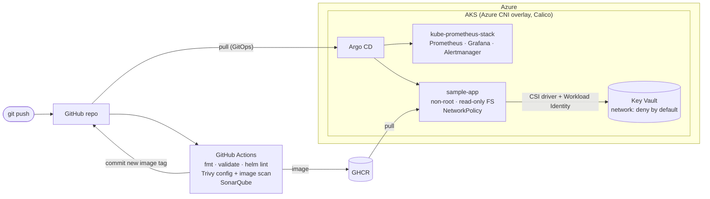

# aks-gitops-platform


A small, complete platform on Azure Kubernetes Service: **Terraform** builds the cluster, **Argo CD** deploys everything from Git, the app reads its secret from **Azure Key Vault** with **Workload Identity** (no stored credentials), **GitHub Actions** scans every change with **Trivy** and **SonarQube**, and **Prometheus/Grafana** watch it.

> This is a personal portfolio and reference project. It is not code from an employer. It uses the same patterns I work with day to day, at a size one person can run for a few hours and then delete.

## Architecture



**The flow:** a push builds and scans the image. If it passes, CI pushes it and writes the new tag into `charts/sample-app/values.yaml`. Argo CD sees the change in Git and rolls it out. CI never holds cluster credentials.

## What's in the repo

| Path | What it does |
|---|---|
| `terraform/network.tf` | Resource group, VNet, AKS subnet with a Key Vault service endpoint |
| `terraform/aks.tf` | AKS: Free tier, OIDC issuer + Workload Identity, Azure CNI overlay with Calico network policy, Key Vault CSI driver, API server limited to your IP |
| `terraform/keyvault.tf` | Key Vault with RBAC and a deny-by-default firewall, plus one demo secret |
| `terraform/identity.tf` | Managed identity for the app, federated with the app's Kubernetes service account, with read-only "Key Vault Secrets User" |
| `gitops/root-app.yaml` | Argo CD "app of apps" root |
| `gitops/apps/` | Argo CD Applications: kube-prometheus-stack (wave 0) and sample-app (wave 1) |
| `charts/sample-app/` | Helm chart: hardened Deployment, Service, NetworkPolicy, SecretProviderClass, PrometheusRule alerts |
| `app/` | Static page on unprivileged nginx (port 8080, UID 101) |
| `.github/workflows/ci.yml` | The pipeline described above |
| `scripts/` | Argo CD bootstrap and Terraform-output-to-Helm-values helper |

## Run it

**You need:** an Azure subscription, Azure CLI (`az login`), Terraform >= 1.6, kubectl, Helm.

```bash
# 0. Fork this repo, then change repoURL in gitops/*.yaml to your fork
export ARM_SUBSCRIPTION_ID=$(az account show --query id -o tsv)
cp terraform/terraform.tfvars.example terraform/terraform.tfvars   # put your IP in admin_ip_cidrs

# 1. Infrastructure (about 10 minutes)
make init plan apply
make kubeconfig

# 2. Point the chart at the new identity and vault, and commit
make values
git add charts/sample-app/values-azure.yaml && git commit -m "Set Azure IDs" && git push

# 3. Hand over to GitOps
make bootstrap
make status
```

The first CI run on `main` publishes the image to GHCR. Set that package to **public** (GitHub → Packages → Package settings) so AKS can pull it without a pull secret.

## Check that it works

```bash
# Argo CD shows both apps Synced and Healthy
kubectl -n argocd get applications

# The secret arrived from Key Vault as a file, without any credential in the cluster
kubectl -n sample-app exec deploy/sample-app -- cat /mnt/secrets/app-message

# The app
kubectl -n sample-app port-forward svc/sample-app 8080:80      # http://localhost:8080

# Grafana (user admin; password in the secret)
kubectl -n monitoring get secret monitoring-grafana -o jsonpath='{.data.admin-password}' | base64 -d; echo
kubectl -n monitoring port-forward svc/monitoring-grafana 3000:80   # http://localhost:3000
```

Try the GitOps loop: change `replicaCount` in `charts/sample-app/values.yaml`, push, and watch Argo CD apply it. Then `kubectl scale` the deployment by hand and watch self-heal put it back.

## Clean up

```bash
make destroy
```

Two small VMs, a load balancer and Key Vault cost money while they exist. Destroy the lab when you're done.

## Design decisions

| Decision | Why |
|---|---|
| Workload Identity instead of a client secret | Nothing to leak or rotate. The pod's service account token is exchanged for an Entra ID token. |
| Key Vault CSI driver mounting a file | The secret never lands in Git or in a Kubernetes Secret object. |
| Key Vault firewall: deny + AKS subnet service endpoint | Only the cluster and the admin's IP can reach the vault. |
| API server authorized IP ranges | Cheaper than a private cluster for a lab, still not open to the internet. |
| GitOps with Argo CD; CI only commits a tag | Git is the single record of what runs. CI has no cluster access. |
| Trivy gates on HIGH/CRITICAL | Blocks fixable vulnerabilities and misconfigurations before they ship. |
| Hardened pod spec + NetworkPolicy | Non-root, read-only root filesystem, all capabilities dropped, seccomp RuntimeDefault, ingress only on 8080. |

## Production gaps (deliberate, to keep the lab small)

- Local Terraform state. Production would use the `azurerm` backend with state locking.
- Single node pool. Production would split system and user pools across availability zones.
- No ingress controller or TLS. Access is by `port-forward`.
- Argo CD uses the default project and admin login. Production would use SSO and scoped AppProjects.
- Key Vault purge protection is off so `destroy` cleans up fully.
